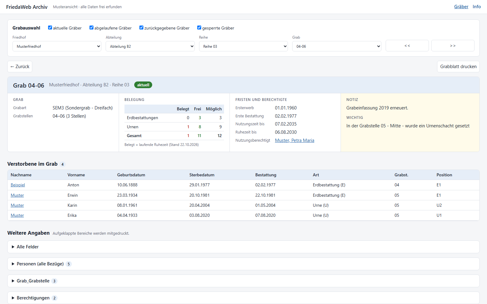
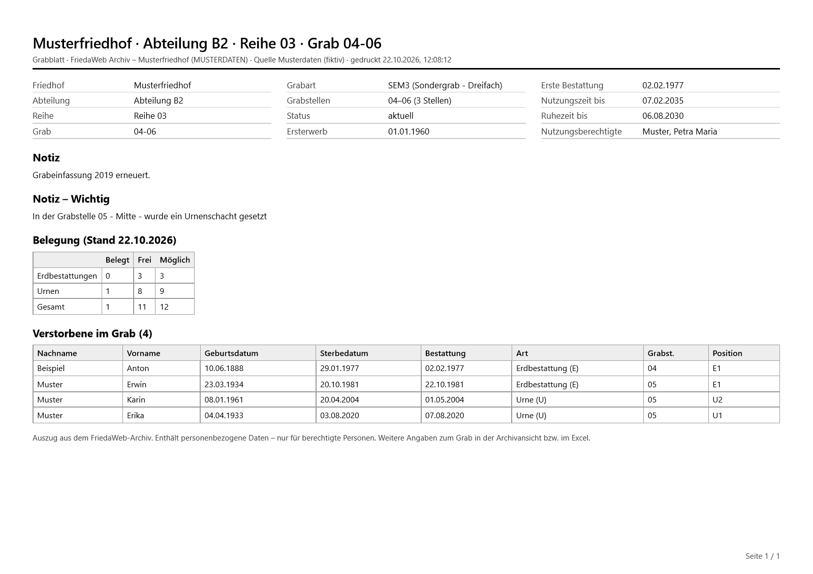

# friedaweb-export – PowerShell (Windows)

Windows-Variante zum Archivieren einer **FriedaWeb**-Datenbank (Friedhofsverwaltung). Aus einer Microsoft-SQL-Server-Sicherung (`.bak`) und, falls vorhanden, dem Dokumentordner des ehemaligen FriedaWeb-Servers entstehen Dateien, die **ohne SQL Server und ohne FriedaWeb** dauerhaft lesbar bleiben:

| Ergebnis | Inhalt | Zweck |
| --- | --- | --- |
| `<backup>.xlsx` | Fachliche Tabellen, weitere Fachtabellen und verwendete Nachschlagetabellen (`Ref_…`) als Blätter, IDs durch Klartext ersetzt, Dokument-Links | Arbeiten und Auswerten in Excel |
| `<backup>.html` | Archivansicht mit Grabauswahl wie in FRIEDA, Grabinfo mit Belegung, Verstorbenen im Grab, Detailseiten, verlinkten Nachschlagewerten, Dokument-Links, Druckvorlage | Nachschlagen im Browser, ohne Installation |
| `<backup>_Dokumente\` | Alle Dokumente als einzelne Dateien, Berichtsvorlagen im Unterordner `Berichtsvorlagen` | Ziel der Links in Excel und HTML |
| `<backup>_Grabblaetter\` | *nur mit `-Grabblaetter`:* je Grab ein Grabblatt als PDF (Grabinfo, Belegung, Verstorbene, Notiz) | Stammdatenblatt je Grab zum Ablegen, Versenden, Drucken |
| `<backup>.sqlite` | *nur mit `-KeepSqlite`:* 1:1-Kopie **aller** Tabellen inkl. IDs und Schlüssel | optional |

**Aufbewahren:** Excel und HTML enthalten alle fachlich relevanten Daten. Die **Original-Sicherung (`.bak`) samt Dokumentordner** bleibt die vollständige Rohquelle (alle Tabellen, z. B. auch Benutzerrechte und Systemeinstellungen) und sollte archiviert werden.

Die Linux-Variante für Hohenems liegt unverändert in [`../linux`](../linux).

**Musteransicht ansehen:** [`muster/FW_Muster.html`](muster/FW_Muster.html) zeigt die Archivansicht mit frei erfundenen Daten (herunterladen bzw. im ausgecheckten Ordner per Doppelklick in Edge öffnen) – Details in [Abschnitt 5.1](#51-musteransicht).

[](muster/FW_Muster.html)

> **Datenschutz (DSGVO):** Alle Ergebnisse enthalten personenbezogene Daten (Verstorbene, Nutzungsberechtigte mit Adressen) und Bankverbindungen (IBAN, BIC, Mandatsnummern). Ablageort, Zugriffsrechte und Weitergabe entsprechend festlegen. Die HTML-Datei ist nicht geschützt; wer sie öffnen kann, sieht alle enthaltenen Daten.

---

## Inhalt

1. [Voraussetzungen und Installation](#1-voraussetzungen-und-installation)
2. [Ordnerstruktur](#2-ordnerstruktur)
3. [Export ausführen](#3-export-ausführen)
4. [Ergebnisse im Detail](#4-ergebnisse-im-detail)
5. [Archivansicht (HTML)](#5-archivansicht-html)
6. [Ablauf und Prüfungen](#6-ablauf-und-prüfungen)
7. [Fehlerbehebung](#7-fehlerbehebung)
8. [Hinweise und Grenzen](#8-hinweise-und-grenzen)

---

## 1. Voraussetzungen und Installation

| Werkzeug | Wofür | Erforderlich |
| --- | --- | --- |
| Windows 10/11 | Laufzeitumgebung | ja |
| PowerShell 7 **oder** Windows PowerShell 5.1 | Ausführung des Skripts | ja (5.1 ist in Windows enthalten) |
| SQL Server Express **LocalDB** (`SqlLocalDB.exe`) | Wiederherstellen der Sicherung | ja |
| `sqlite3.exe` | Erzeugen der SQLite-Datei | ja |
| Microsoft Edge oder anderer aktueller Browser | Archivansicht öffnen | nur zum Ansehen |
| Microsoft Excel | Excel-Datei öffnen | nur zum Ansehen |

Nicht benötigt: Docker, Python, zusätzliche PowerShell-Module, Internetzugang während des Exports, Administratorrechte für den Export selbst.

**Speicherbedarf:** Im Arbeitsordner `%TEMP%` werden während des Laufs etwa das Drei- bis Vierfache der Sicherung benötigt (wiederhergestellte Datenbank, SQL-Zwischendatei, Ergebnisse). Als Richtwert: Eine Sicherung von rund 1 GB benötigt etwa 3 GB Arbeitsplatz; die Ergebnisse selbst (Excel, HTML, Dokumentordner) sind meist kleiner als die Sicherung.

### 1.1 PowerShell prüfen

```powershell
$PSVersionTable.PSVersion
```

5.1 oder höher genügt. PowerShell 7 ist schneller und kann optional installiert werden:

```powershell
winget install --id Microsoft.PowerShell --exact
```

### 1.2 SQL Server Express LocalDB installieren

LocalDB ist eine kostenlose, schlanke SQL-Server-Variante von Microsoft, die unter dem angemeldeten Benutzer läuft.

1. Prüfen, ob LocalDB bereits vorhanden ist:

   ```powershell
   SqlLocalDB versions
   ```

   Erscheint eine Liste von Versionen (z. B. `Microsoft SQL Server 2019 (15.0.x)`), ist nichts weiter zu tun.

2. Sonst installieren: Den Installer von **SQL Server Express** von der Microsoft-Seite [SQL Server-Downloads](https://www.microsoft.com/de-de/sql-server/sql-server-downloads) laden, starten, **„Medien herunterladen“** wählen, dort **„LocalDB“** auswählen und die heruntergeladene Datei `SqlLocalDB.msi` installieren. Für die Installation sind Administratorrechte nötig. Beschreibung von Microsoft: [SQL Server Express LocalDB](https://learn.microsoft.com/de-de/sql/database-engine/configure-windows/sql-server-express-localdb).

3. **Version beachten:** Eine Sicherung lässt sich nur mit einer gleichen oder neueren SQL-Server-Version wiederherstellen. Beispiel: Eine Sicherung aus SQL Server 2012 lässt sich mit LocalDB 2019 wiederherstellen. Sind mehrere Versionen installiert, nimmt das Skript die neueste; eine bestimmte lässt sich mit `-LocalDbVersion` wählen (z. B. `15.0` = 2019, `16.0` = 2022).

### 1.3 sqlite3 installieren

Offizielles Kommandozeilenwerkzeug von [sqlite.org](https://sqlite.org), Installation im Benutzerprofil ohne Administratorrechte:

```powershell
winget install --id SQLite.SQLite --exact --scope user
```

Das Skript findet `sqlite3.exe` über `PATH` oder direkt im winget-Paketordner, also auch ohne Neustart der Konsole. Alternativ das Programm von sqlite.org herunterladen und den Pfad mit `-Sqlite3Path` angeben.

### 1.4 Ausführungsrichtlinie

Falls Windows das Skript wegen der Ausführungsrichtlinie blockiert, kann es für einen einzelnen Aufruf so gestartet werden, ohne die Einstellung dauerhaft zu ändern:

```powershell
pwsh -ExecutionPolicy Bypass -File .\Export-FriedaWeb.ps1
```

Mit Windows PowerShell 5.1 entsprechend `powershell -ExecutionPolicy Bypass -File .\Export-FriedaWeb.ps1`. Aus dem Internet geladene Dateien ggf. vorher mit `Unblock-File` freigeben.

---

## 2. Ordnerstruktur

```text
powershell/
├── Export-FriedaWeb.ps1            Exportskript
├── Export-FriedaWeb.Viewer.html    Vorlage der Archivansicht (wird beim Export mit Daten gefüllt)
├── Export-FriedaWebGrabblaetter.ps1  Grabblätter als PDF (auch ohne neuen Export neu erstellbar)
├── New-FriedaWebMuster.ps1         erzeugt die Musteransicht aus der Vorlage (frei erfundene Daten)
├── README.md
├── muster/                         Musteransicht, Bild der Grabseite, Muster-Grabblatt (PDF + Vorschau) – versioniert, keine echten Daten
├── backup/                         Eingang: hier die .bak-Datei und ggf. den Ordner "Dokumente" ablegen
└── export/                         Ausgang: Excel, HTML, SQLite, Dokumentordner und ggf. Grabblätter
```

Der **Inhalt** von `backup/` und `export/` ist per `.gitignore` vom Repository ausgeschlossen und darf nie eingecheckt werden; versioniert sind dort nur die Platzhalter `.gitkeep`. Zusätzlich sind `*.bak`, `*.sqlite`, `*.xlsx`, `*.mdf`, `*.ldf`, `*.csv`, `*.zip` und `*.7z` überall ausgeschlossen.

**Dokumentordner:** Hat FriedaWeb Dokumente nicht (nur) in der Datenbank, sondern auf dem Server abgelegt, den Ordner `Dokumente` vom ehemaligen Server neben die Sicherung kopieren:

```text
backup/
├── FW_Beispiel_20260101.bak
└── Dokumente/
    ├── 0/…
    └── 1/…
```

---

## 3. Export ausführen

```powershell
cd powershell
# .bak (und ggf. Ordner Dokumente) nach .\backup kopieren, dann:
.\Export-FriedaWeb.ps1
```

Ohne Parameter muss in `backup/` **genau eine** `.bak`-Datei liegen. Die Ergebnisse landen in `export/` und heißen wie die Sicherung (`FW_Beispiel_20260101.bak` → `FW_Beispiel_20260101.xlsx` …). Vorhandene Ergebnisse gleichen Namens werden überschrieben, ebenso der zugehörige Dokumentordner.

### Parameter

| Parameter | Standard | Bedeutung |
| --- | --- | --- |
| `-BackupPath` | einzige `.bak` in `backup\` | Pfad zur Sicherung |
| `-OutputPath` | `export\` | Ausgabeordner (wird bei Bedarf angelegt) |
| `-DocumentPath` | Ordner `Dokumente` neben der Sicherung | Dokumentordner des ehemaligen Servers |
| `-Sqlite3Path` | Suche über `PATH`/winget | Pfad zu `sqlite3.exe` |
| `-LocalDbVersion` | neueste installierte | z. B. `15.0` oder `16.0` |
| `-KeepSqlite` | aus | SQLite-Kopie aller Tabellen zusätzlich ausgeben (sonst nur intern für die Prüfungen) |
| `-Grabblaetter` | aus | nach dem Export je Grab ein Grabblatt als PDF erzeugen (siehe [4.4](#44-grabblätter-pdf)); benötigt Microsoft Edge |

Beispiel mit eigenen Pfaden:

```powershell
.\Export-FriedaWeb.ps1 -BackupPath D:\Archiv\FW_Beispiel.bak -DocumentPath D:\Archiv\Dokumente -OutputPath D:\Export
```

Ausführliche Hilfe: `Get-Help .\Export-FriedaWeb.ps1 -Full`

### Ausgabe am Bildschirm (Beispiel, Zahlen fiktiv)

```text
Restore FW_Beispiel aus …\backup\FW_Beispiel_20260101.bak …
Geprüft: 214 Tabellen (SQLite-Kopie nur intern; mit -KeepSqlite behalten)
Excel:  …\export\FW_Beispiel_20260101.xlsx
HTML:   …\export\FW_Beispiel_20260101.html (Archivansicht mit Suche, im Browser öffnen)
  Gräber                 1234
  …
  Ref_Verwandtschaft       10
Dokumente: …\export\FW_Beispiel_20260101_Dokumente (4321 Dateien, davon 12 ohne Datenbankbezug)
  Einträge: 1000 aus Dateisystem, 3300 aus Datenbank, 0 nicht gefunden
HINWEIS SQLite: <Tabelle>: <n> Verweise passen nur ohne Groß-/Kleinschreibung …
```

Laufzeit: bei einer Sicherung von rund 1 GB mit mehreren tausend Dokumenten wenige Minuten. **ExitCode** 0 bei Erfolg, 1 bei Fehler (für den Einsatz in Aufgabenplanung oder Skripten).

---

## 4. Ergebnisse im Detail

### 4.1 Excel

- Blatt **Info**: Quelle, Friedhof, letzter Sterbefall, letzte Änderung, Dokumentstatistik, Hinweise, Zeilenzahl je Blatt.
- **Verstorbene im Grab** (direkt nach „Gräber“): abgeleitetes Blatt mit den Bestatteten je Grab – Friedhof, Abteilung, Reihe, Grabnummer, Name, Geburts-, Sterbe- und Bestattungsdatum, Bestattungsart, Grabstelle, Position, Ruhezeit bis. Quelle ist die Personentabelle mit Grabverweis (`tbl_Person` mit `Kategorie_B` = bestattet, sonst `tbl_Verstorbener`); `Grab_ID` und `Person_ID` verweisen auf die Quellblätter. Nur in Excel und HTML, nicht in SQLite.
- Je ein Blatt für Gräber, Grabstellen, Grab_Grabstelle, Verstorbene, Verstorbene_Archiv, Personen, Berechtigte, Berechtigte_Archiv, Berechtigungen, Nutzungsverlauf, Abrechnungen, Bescheide, Dokumente, Dokumentablage, Verlauf und Ereignisprotokoll – jeweils soweit in der Sicherung vorhanden. **Blätter ohne Zeilen entfallen**; das Info-Blatt nennt sie, in SQLite bleiben sie enthalten.
- **Weitere Fachtabellen** (soweit vorhanden): Protokoll, Sperrungen, Grabkontrollen, Kontrollmängel, Grabmalgenehmigungen, Grabmalauflagen, Rechnungsempfänger, Bankverbindung, Berichtsvorlagen.
- **Nachschlagetabellen `Ref_…`:** jede Nachschlagetabelle, auf die eine exportierte Tabelle verweist, mit allen Feldern (z. B. `Ref_Firma` mit Adressen und Telefon, `Ref_Gebuehr` mit Beträgen und Gültigkeit, `Ref_Grabart` mit Ruhe-/Nutzungsdauern).
- Nachschlage-IDs (Grabart, Reihe, Konfession, Firma …) sind durch Klartext ersetzt; die Überschrift verliert Präfix und `_ID`. Hat eine Nachschlagetabelle keine Bezeichnung, wird ihr inhaltliches Feld gezeigt (z. B. Anrede „Frau/Herr“).
- **Ergänzte Verknüpfungen:** Einige Bezüge speichert FriedaWeb ohne Fremdschlüssel (z. B. Bescheid → Grab, Abrechnung → Person, Dokument → Person, Sperrung → Grabstelle). Sie werden als Klartext bzw. Verknüpfung dargestellt, aber nur, wenn jede ID im Ziel existiert; das Info-Blatt listet sie auf.
- Verweise auf ein **Grab** behalten die ID und erhalten daneben die Spalte „Grab“ (`Reihe / Grabnummer`); Verweise auf **Personen** behalten die ID und erhalten „Nachname, Vorname“; Verweise auf eine **Grabstelle** behalten die ID und erhalten „Reihe / Grabstelle“. Der Verweis einer Person auf die Zuordnung Grab–Grabstelle zeigt die Bezeichnung der Grabstelle (z. B. „02“). Über die IDs lassen sich Blätter per XVERWEIS verbinden.
- „Titel#Pfad“-Felder sind in Titel und Pfad geteilt; die Binärspalte `Daten` ist durch **Datei** (Link) und **Dateiquelle** ersetzt.
- Echte Datumswerte (TT.MM.JJJJ), Texte immer als Text (kein Ausführen von `=…` als Formel), erste Zeile fixiert, Autofilter.

### 4.2 SQLite (optional)

Wird immer intern erzeugt und für die Prüfungen verwendet, aber nur mit `-KeepSqlite` ausgegeben. Enthält alle Tabellen mit allen Zeilen, Original-Spaltennamen, Primär- und Fremdschlüsseln sowie eingebettete Dokumente als BLOB. Abfrage z. B. mit `sqlite3`:

```powershell
sqlite3 FW_Beispiel_20260101.sqlite "SELECT Nachname, Vorname, Sterbedatum FROM tbl_Person WHERE Nachname LIKE 'Muster%'"
```

### 4.3 Dokumente

Alle Dokumente landen **genau einmal** in **einem** Ordner `<backup>_Dokumente` (ohne Unterordner):

1. Vorrang hat die Datei aus dem Dokumentordner (Dateisystem); sie behält ihren Originalnamen.
2. Fehlt sie dort, wird die in der Datenbank eingebettete Fassung geschrieben; die Endung richtet sich nach dem tatsächlichen Inhalt (z. B. `.docx` statt `.doc`).
3. Mehrere Einträge mit derselben Datei verweisen auf dieselbe Datei; bei Namensgleichheit verschiedener Dateien wird die ID bzw. der Herkunftsordner vorangestellt.
4. Dateien im Dokumentordner ohne Bezug in der Datenbank werden ebenfalls übernommen.
5. **Berichtsvorlagen** (`tbl_Bericht`) liegen getrennt im Unterordner `Berichtsvorlagen` und sind im Blatt „Berichtsvorlagen“ verlinkt.

Excel und HTML verlinken **relativ** auf diesen Ordner: Ergebnisdateien und Dokumentordner daher immer gemeinsam ablegen bzw. verschieben.

### 4.4 Grabblätter (PDF)

Mit `-Grabblaetter` entsteht nach dem Export für **jedes Grab** ein Stammdatenblatt als PDF im Ordner `<backup>_Grabblaetter` neben dem Dokumentordner:

- **Inhalt = Druck „Grabblatt drucken“** in der Archivansicht, ohne aufgeklappte Bereiche: Grabinfo, Status, Fristen, Nutzungsberechtigte, Notiz, Belegung und Verstorbene im Grab (A4 quer, meist eine Seite).
- **Dateiname = Titel des Grabblatts**, z. B. `Friedhof … · Abteilung A1 · Reihe 01 · Grab 01-03.pdf`. Gibt es denselben Titel mehrfach (z. B. ein zurückgegebenes und ein neues Grab mit gleicher Nummer), folgt der Status, z. B. `… Grab 04-06 (zurückgegeben).pdf`.
- **Stichtag:** Belegung und Ruhezeit-Kennzeichnung beziehen sich auf den Tag der Erzeugung (im Kopf „gedruckt …“).
- **Neu erstellen ohne neuen Export**, z. B. nach Änderungen an der Druckvorlage in `Export-FriedaWeb.Viewer.html`:

  ```powershell
  .\Export-FriedaWebGrabblaetter.ps1                      # Archivansicht in .\export
  .\Export-FriedaWebGrabblaetter.ps1 -HtmlPath D:\Export\FW_Beispiel_20260101.html
  ```

  Das Skript bringt die Archivansicht zuerst auf die aktuelle Vorlage (Daten unverändert), damit PDF und Druck identisch aussehen, und ersetzt danach den Ordner `<backup>_Grabblaetter` vollständig. Mit `-KeepTemplate` bleibt die Archivansicht unverändert.
- **Technik:** Microsoft Edge läuft dabei einmalig unsichtbar im Hintergrund (eigenes temporäres Profil, Steuerung nur lokal über 127.0.0.1) und wird danach beendet; das normal geöffnete Edge ist nicht betroffen.
- **Datenschutz:** Die PDFs enthalten dieselben personenbezogenen Daten wie Excel und HTML.

**Muster eines Grabblatts** (frei erfundene Daten): [`muster/FW_Muster_Grabblatt.pdf`](muster/FW_Muster_Grabblatt.pdf)

[](muster/FW_Muster_Grabblatt.pdf)

---

## 5. Archivansicht (HTML)

`<backup>.html` per Doppelklick öffnen (Edge). Die Datei enthält alle Daten selbst und läuft offline, ohne Server und ohne Installation. **Nur Lesen.**

- **Grabauswahl wie in FRIEDA** (Startseite): Kennzeichen *aktuelle / abgelaufene / zurückgegebene / gesperrte Gräber*, Auswahl Friedhof → Abteilung → Reihe → Grab, Blättern mit `<<` `>>`. Darunter die Trefferliste mit Schnellsuche (Grabnummer oder Name der Verstorbenen) und „nur mit Dokumenten“. Eine eigene Personensuche gibt es nicht; Personen sind über das Grab erreichbar.
- **Grabstatus** (Vorrang in dieser Reihenfolge): *gesperrt* = eine Sperrung des Grabs bzw. einer ihm heute zugeordneten Grabstelle gilt heute; *zurückgegeben* = Rückgabedatum erreicht; *abgelaufen* = Nutzungszeit vor heute beendet; sonst *aktuell*.
- **Grabseite:** Kopfzeile mit Grabnummer, Friedhof · Abteilung · Reihe und farbigem Status; darunter vier Spalten nebeneinander (bei schmalem Fenster 2×2): **Grab** (Grabart, Grabstellen, z. B. „01–03 (3 Stellen)“), **Belegung** (Belegt / Frei / Möglich für Erdbestattungen und Urnen), **Fristen und Berechtigte** (Ersterwerb, erste Bestattung, Nutzungszeit bis, Ruhezeit bis – rot, wenn abgelaufen –, aktuell Nutzungsberechtigte) und **Notiz** (Notizfelder des Grabs, z. B. Notiz, wichtige Notiz, Grabkontrolle); Tabelle **Verstorbene im Grab** (Nachname, Vorname, Geburts-, Sterbe- und Bestattungsdatum, Art mit E = Erd-/U = Urnenbestattung, Grabstelle, Position). Alle übrigen Angaben (alle Felder, Personen mit allen Bezügen, Berechtigungen, Nutzungsverlauf, Bescheide, Dokumente, weitere Fachtabellen) stehen **eingeklappt** unter „Weitere Angaben“.
- **Belegung:** „Möglich“ = Erd- bzw. Urnenplätze laut Grabstellen-Zuordnung (Kennzeichen E1 … / U1 …), „Belegt“ = Bestattete mit laufender Ruhezeit, „Frei“ = Differenz – jeweils zum heutigen Datum berechnet. Ohne Platz-Kennzeichen im Datenmodell entfällt die Tabelle.
- **Detailseiten** (Personen, Nachschlagewerte, weitere Tabellen): alle Felder und alle verknüpften Daten. Verweise und Zeilen sind anklickbar; „Zurück“ funktioniert wie gewohnt. Ja/Nein-Werte erscheinen in Tabellen als Häkchen.
- **Nachschlagewerte als Link:** Klartexte wie Friedhof, Grabart, Bestatter oder Gebühr öffnen die Detailseite des Eintrags mit allen Feldern (z. B. Adresse und Telefon des Bestatters).
- **Weitere Fachtabellen** (Grabkontrollen, Grabmalgenehmigungen, Protokoll …) erscheinen als **eingeklappte Unterpunkte** an Grab bzw. Bescheid; ebenso die Rückverweise einer Nachschlagetabelle (z. B. alle Gräber einer Grabart).
- **Info-Seite:** Liste aller Tabellen (Hauptbereiche, weitere Fachtabellen, Nachschlagetabellen); jede lässt sich als Liste mit Suche öffnen.
- **Sortieren** per Klick auf die Spaltenüberschrift, **Trefferliste als CSV**.
- **Drucken** (Knopf oder Strg+P): eigene Druckvorlage im Querformat A4. **Gedruckt wird, was aufgeklappt ist:** an der Grabseite immer das Grabblatt (Grabinfo, Belegung, Verstorbene im Grab), dazu jeder geöffnete Bereich unter „Weitere Angaben“; an anderen Detailseiten die Felder und die sichtbaren bzw. geöffneten Bereiche. Breite Bereiche erscheinen als Datensatz-Blöcke; Trefferlisten vollständig mit Filterangabe. Für die Seitenzahl in Edge unter *Weitere Einstellungen* die Option **„Kopf- und Fußzeilen“ deaktivieren**.
- **Dokumente:** Klick auf den Dateinamen öffnet das Dokument; **„Pfad“** kopiert den vollständigen Dateipfad (z. B. zum Öffnen im Explorer).

Nicht enthalten sind die reinen Protokolle (Verlauf, Ereignisprotokoll); diese stehen in Excel und SQLite.

### 5.1 Musteransicht

[`muster/FW_Muster.html`](muster/FW_Muster.html) ist die Archivansicht mit einem **frei erfundenen** Datenbestand (dazu das Muster-Grabblatt [`muster/FW_Muster_Grabblatt.pdf`](muster/FW_Muster_Grabblatt.pdf), siehe [4.4](#44-grabblätter-pdf)): Musterfriedhof, Abteilung B2, Reihe 03, vier Gräber mit den Status aktuell, abgelaufen und zurückgegeben sowie erfundenen Verstorbenen, Nutzungsberechtigten und Notizen. Sie eignet sich zum Vorführen, für Schulungen und für Screenshots, weil sie **keine echten Personendaten** enthält.

- **Öffnen:** im ausgecheckten Repository `powershell\muster\FW_Muster.html` per Doppelklick (Edge). Auf GitHub die Datei öffnen, *Download raw file* wählen und die heruntergeladene Datei öffnen – GitHub selbst zeigt HTML-Dateien nur als Quelltext an.
- **Neu erzeugen** (z. B. nach Änderungen an `Export-FriedaWeb.Viewer.html`):

  ```powershell
  .\New-FriedaWebMuster.ps1              # nur die Musteransicht
  .\New-FriedaWebMuster.ps1 -Screenshot  # zusätzlich Bild der Grabseite und Muster-Grabblatt (PDF + Vorschau); benötigt Microsoft Edge
  ```

- Für Screenshots aus einem **echten** Export gilt: Namen, Datumsangaben, Grabnummer, Abteilung/Reihe und Grabstellen vollständig abdecken (deckende Balken statt Weichzeichner) – sonst bleiben Personen über die Grablage bestimmbar. Einfacher ist, die Musteransicht zu verwenden.

---

## 6. Ablauf und Prüfungen

1. `SqlLocalDB.exe` und `sqlite3.exe` werden gesucht.
2. Eine eigene LocalDB-Instanz `fwrestore_<PID>` wird angelegt (Windows-Anmeldung, kein Passwort, kein Netzwerkport).
3. Die Sicherung wird in einen Arbeitsordner unter `%TEMP%` wiederhergestellt; die `.bak` wird nur gelesen. Ältere Sicherungen werden dabei auf das LocalDB-Format aktualisiert, die Daten bleiben unverändert.
4. SQLite (intern), Dokumente, Excel und HTML werden im Arbeitsordner erzeugt und geprüft; erst danach werden Excel, HTML und Dokumentordner (und mit `-KeepSqlite` die SQLite-Datei) in den Ausgabeordner verschoben.
5. LocalDB-Instanz und Arbeitsordner werden **in jedem Fall** entfernt – auch bei Fehlern oder Strg+C (bei Strg+C nach Ende des gerade laufenden SQL-Befehls).

**Prüfungen** (Abbruch mit ExitCode 1):

- Zeilenzahl jeder Tabelle in SQLite = Quelle.
- Keine Fremdschlüssel-Verletzungen in SQLite. Ausnahme: Textschlüssel, die nur nach SQL-Server-Regeln (ohne Groß-/Kleinschreibung, ohne Leerzeichen am Ende) zusammenpassen, werden als **HINWEIS** gemeldet; die Werte bleiben unverändert.
- Kein Text länger als 32.767 Zeichen (Excel-Grenze).

**Warnungen** (kein Abbruch): Verweise ohne Nachschlagewert erscheinen als `?<ID>`; nicht gefundene Dokumente haben die Dateiquelle „fehlt“.

---

## 7. Fehlerbehebung

| Meldung | Ursache und Lösung |
| --- | --- |
| `SqlLocalDB wurde nicht gefunden` | LocalDB installieren (Abschnitt 1.2). |
| `sqlite3 wurde nicht gefunden` | sqlite3 installieren (1.3) oder `-Sqlite3Path` angeben. |
| `Im Ordner … muss genau eine .bak-Datei liegen` | Nur eine Sicherung in `backup\` ablegen oder `-BackupPath` angeben. |
| Fehler beim `RESTORE` / „volume … is empty“ | Datei ist keine SQL-Server-Vollsicherung oder beschädigt. |
| RESTORE meldet eine inkompatible bzw. neuere Version | LocalDB ist älter als die SQL-Server-Version der Sicherung: neuere LocalDB installieren, ggf. `-LocalDbVersion`. |
| `SQL Server nicht erreichbar` | LocalDB startet nicht; `SqlLocalDB info` prüfen, ggf. LocalDB reparieren. |
| `Tabellen fehlen: …` | Die Datenbank stammt nicht aus FriedaWeb oder aus einer stark abweichenden Version. |
| `FK-Verletzungen in SQLite` | Unerwartete Inkonsistenz; Meldung enthält die betroffenen Zeilen. |
| Skript startet nicht (Ausführungsrichtlinie) | Siehe 1.4. |
| Dokument-Link öffnet nicht | HTML/Excel und Ordner `<backup>_Dokumente` müssen im selben Ordner liegen; alternativ „Pfad“ kopieren. |
| Kein Speicherplatz | Freien Platz in `%TEMP%` prüfen (Abschnitt 1). |

---

## 8. Hinweise und Grenzen

- **Nur FriedaWeb:** Blattauswahl und Aufbereitung sind auf FriedaWeb-Tabellen zugeschnitten (z. B. `tbl_Grab`, `tbl_Person`, `tbl_Dokument`). Unterschiedliche FriedaWeb-Datenmodelle (Verstorbene/Berechtigte in eigenen Tabellen oder gemeinsame Personentabelle) werden berücksichtigt.
- **Edge und Office-Dokumente:** Beim Öffnen eines `.doc`/`.docx` über einen Link legt Edge eine Kopie im Download-Ordner ab. Wer das vermeiden möchte, nutzt „Pfad“ und öffnet die Datei über den Explorer. PDFs zeigt Edge direkt an.
- **1900-01-01** wurde in FriedaWeb als Platzhalter für unbekannte Datumswerte verwendet und ist unverändert übernommen.
- **`Kategorie_B`** in `tbl_Person` kennzeichnet in FriedaWeb Bestattete, nicht Berechtigte; als „Berechtigte“ gelten in der Archivansicht die Einträge der Berechtigungstabelle.
- Die Archivansicht ist eine Momentaufnahme des Exports; Änderungen sind nicht vorgesehen.
- **Nicht verknüpft** werden Verweise, die sich nicht eindeutig zuordnen lassen, z. B. Archiv-Verweise `Verstorbener_ID`, die auf keine vorhandene Person zeigen, sowie Grabkontrollen, wenn nicht jede Grab-ID existiert; diese Werte bleiben als ID bzw. als eigene Textangaben (Friedhof, Reihe, Grabnummer) erhalten.
- Nicht in Excel/HTML (nur in der `.bak`): Benutzerrollen und -rechte, Programmeinstellungen, Symbolleisten und ungenutzte Nachschlagelisten wie PLZ- und BLZ-Verzeichnis.

---

## Lizenz

MIT, siehe [LICENSE](../LICENSE). Die PowerShell-Variante basiert auf der Linux-Variante von Alexander Waller.
